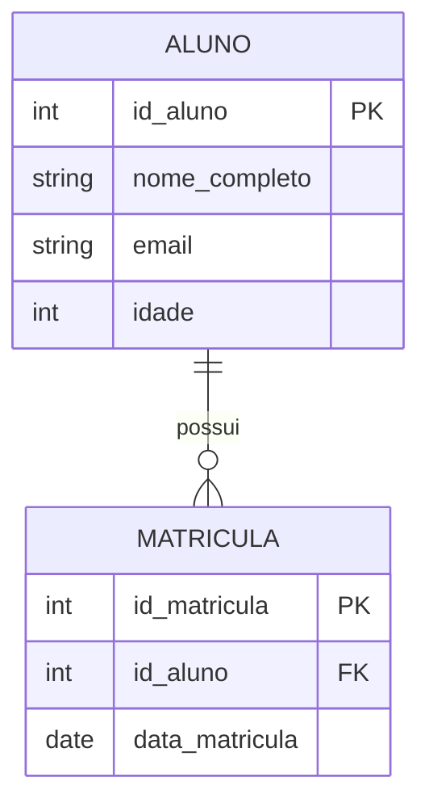

# 📚 MAPEAMENTO DE RESTIÇÕES E USO DE CHAVES EM BANCO DE DADOS

## 🎯 Introdução
Na modelagem de bancos de dados relacionais, um dos erros mais comuns entre iniciantes é focar exclusivamente na criação de tabelas e colunas, negligenciando as regras que governam a qualidade desses dados. Ao projetar um sistema, não basta definir apenas o local onde a informação será armazenada. É absolutamente fundamental garantir que cada dado inserido seja válido, consistente e reflita fielmente as regras de negócio da organização. É nesse contexto essencial que surgem os conceitos de restrições (*constraints*) e o uso estratégico de chaves (*keys*).

Restrições são regras formais aplicadas a nível de coluna ou de tabela inteira com o objetivo de limitar o tipo de dado que pode ser inserido, atualizado ou excluído. Elas atuam como guardiãs automáticas da integridade dos dados. As chaves, por sua vez, representam um tipo especial e crucial de restrição, utilizada para identificar de forma única cada registro e estabelecer relacionamentos confiáveis entre entidades.

> ⚠️ **Ponto de atenção:** Sem a aplicação rigorosa dessas regras, o banco pode aceitar registros duplicados, permitir campos nulos vitais ou criar relacionamentos órfãos (ex: uma matrícula sem aluno), comprometendo a integridade referencial e a qualidade da informação.

---

## ⚙️ Principais pilares de restrições
Para compreender o mapeamento de restrições, é necessário detalhar os cinco pilares principais que sustentam a integridade de um banco de dados relacional.

1. **Chave Primária (Primary Key - PK):** Identificador único e exclusivo de cada registro. Não pode conter valores nulos e não pode se repetir (ex: `id_aluno`).
2. **Chave Estrangeira (Foreign Key - FK):** Garante a integridade referencial. É um campo que faz referência direta à PK de outra tabela (ex: `id_aluno` dentro da tabela `MATRICULA`).
3. **Restrição de Unicidade (UNIQUE):** Garante que todos os valores em uma coluna sejam diferentes. Permite valores nulos (dependendo do SGBD). Ex: campo `email`.
4. **Restrição de Não Nulo (NOT NULL):** Impede que um campo seja deixado em branco. Ex: `nome_completo`.
5. **Restrição de Verificação (CHECK):** Valida se o valor inserido atende a uma condição lógica ou matemática específica. Ex: `idade >= 16`.

> 💡 **Dica:** No mapeamento de relacionamentos, em um cenário 1:N, a PK do lado "um" migra para o lado "muitos" como FK. Em cenários N:M, é obrigatória a criação de uma terceira tabela (associativa) contendo as FKs de ambas as entidades originais.

### Exemplo Prático: Do MER ao SQL
Considere o sistema de gestão de uma escola com as entidades `ALUNO` e `MATRICULA`.



A tradução desse mapeamento para a linguagem SQL demonstra claramente como as restrições são declaradas:

```sql
CREATE TABLE Aluno (
    id_aluno INT PRIMARY KEY,          -- Define a chave primária, garantindo unicidade e não nulidade automática
    nome_completo VARCHAR(100) NOT NULL, -- Restrição NOT NULL: o nome é um dado obrigatório
    email VARCHAR(100) UNIQUE,         -- Restrição UNIQUE: impede dois alunos com o mesmo e-mail
    idade INT CHECK (idade >= 16)      -- Restrição CHECK: valida a regra de negócio de idade mínima
);
```

---

## 🏁 Conclusão
Em síntese, o mapeamento de restrições e o uso correto de chaves constituem os pilares inegociáveis da integridade de dados. A PK garante a identidade, a FK assegura relacionamentos lógicos, e as restrições (UNIQUE, NOT NULL, CHECK) validam os atributos. 

Um banco de dados sem restrições é análogo a uma planilha sem validação: vulnerável a erros humanos e inconsistências que se propagam silenciosamente. Dominar este tema capacita o técnico em informática a projetar estruturas de dados confiáveis, onde cada restrição declarada no SQL é a proteção automática de uma regra de negócio essencial.
