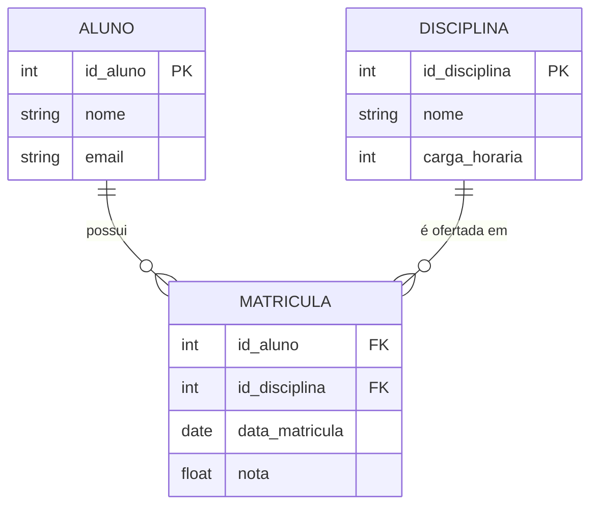

# 🗄️ FUNDAMENTOS DA MODELAGEM DE DADOS: DO MER AO MODELO RELACIONAL

## 📌 Introdução
O desenvolvimento de sistemas de informação robustos e eficientes depende diretamente da qualidade da estrutura de dados que os sustenta. Antes de escrever qualquer linha de código SQL ou configurar um servidor de banco de dados, é fundamental compreender e organizar os requisitos do negócio. É nesse contexto que surge a Modelagem de Dados Conceitual, tendo como principal ferramenta o **Modelo Entidade-Relacionamento (MER)** e sua representação visual, o **Diagrama Entidade-Relacionamento (DER)**. 

O MER é uma abordagem conceitual que permite abstrair a realidade do negócio, identificando quais dados precisam ser armazenados e como eles se relacionam entre si, independentemente de detalhes técnicos de implementação. O DER, por sua vez, é a materialização gráfica desse modelo, utilizando uma notação padronizada para facilitar a comunicação entre desenvolvedores, analistas e clientes. 

> 💡 **Dica:** Pense no DER como a "planta baixa" de uma casa. Você não começa a construir paredes sem antes ter o desenho aprovado, pois corrigir erros na fase de modelagem é infinitamente mais barato do que corrigir no banco de dados em produção.

A importância desse processo reside na prevenção de problemas futuros. Um banco de dados mal modelado pode levar a redundância de informações, inconsistências nos dados, dificuldade de manutenção e baixo desempenho nas consultas. Ao dominar a transição do MER para o Modelo Relacional, o técnico em informática adquire a capacidade de traduzir regras de negócio em uma estrutura lógica sólida.

---

## ⚙️ Modelo Entidade Relacionamento
O Modelo Entidade-Relacionamento é composto por três elementos fundamentais: **entidades**, **atributos** e **relacionamentos**. 
- **Entidade:** Representa um objeto do mundo real com existência própria (ex: "Aluno", "Disciplina"). No DER, é um retângulo.
- **Atributo:** Características ou propriedades dessas entidades (ex: "nome", "email"). 
- **Chave Primária (PK):** Atributo que identifica de forma única cada ocorrência de uma entidade. No DER, é sublinhada.
- **Relacionamento:** Associação semântica entre entidades (losango). Possui **cardinalidade** (1:1, 1:N, N:M), que define a quantidade de associações permitidas.

### Exemplo Prático: Sistema Acadêmico
Considere as entidades `Aluno` (`id_aluno`, `nome`, `email`) e `Disciplina` (`id_disciplina`, `nome`, `carga_horaria`). Um aluno pode se matricular em várias disciplinas, e uma disciplina pode ter vários alunos. Isso configura um relacionamento muitos para muitos (N:M) chamado `Matricula`, com atributos próprios como `data_matricula` e `nota`.



> ⚠️ **Ponto de atenção:** No Modelo Relacional, **não existe** relacionamento muitos para muitos direto entre tabelas. Ele deve ser obrigatoriamente resolvido com uma tabela associativa (ou *junction table*).

### Regras de Mapeamento para o Modelo Relacional
1. Cada entidade do MER torna-se uma **Tabela**.
2. Cada atributo torna-se uma **Coluna**.
3. Relacionamentos 1:N são resolvidos adicionando a chave primária do lado "1" como chave estrangeira (FK) no lado "N".
4. Relacionamentos N:M geram uma **nova tabela** contendo as chaves primárias das entidades originais como chaves estrangeiras.

Exemplo de tradução da entidade `Aluno` para SQL:
```sql
-- Cria a tabela Aluno no banco de dados
CREATE TABLE Aluno (
    -- Coluna id_aluno: número inteiro, chave primária, não pode ser nula
    id_aluno INT PRIMARY KEY NOT NULL,
    -- Coluna nome: texto de até 100 caracteres, obrigatório
    nome VARCHAR(100) NOT NULL,
    -- Coluna email: texto de até 150 caracteres, deve ser único no banco
    email VARCHAR(150) UNIQUE
);
```

---

## 🎯 Conclusão
A modelagem de dados é o alicerce que determina a escalabilidade e a robustez de um sistema. Ao utilizar o MER e o DER, o profissional visualiza claramente as regras de negócio antes da implementação técnica. 

A tradução correta para o Modelo Relacional, respeitando as regras de mapeamento (especialmente em relacionamentos N:M), garante a aplicação das formas normais, eliminando anomalias de inserção, atualização e exclusão, e promovendo a integridade referencial. Dominar essa competência permite não apenas escrever comandos SQL, mas entender o "porquê" da estrutura do banco de dados, preparando o aluno para tópicos avançados com segurança e lógica consistente.
