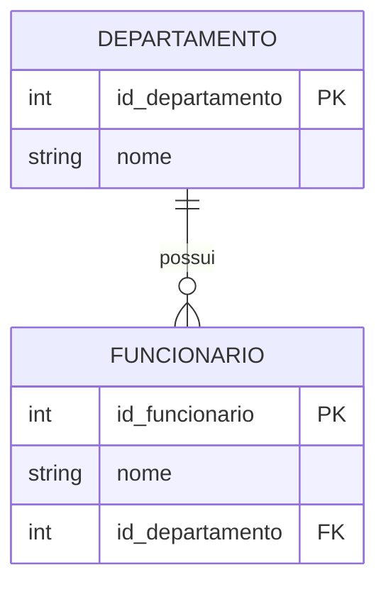

# 🛡️ Integridade Referencial e Implementação em SQL

Em um sistema de banco de dados relacional, os dados raramente existem de forma isolada. Eles se relacionam entre si para representar a realidade de um negócio, como a conexão entre um cliente e seus pedidos, ou entre um departamento e seus funcionários. No entanto, essa liberdade de relacionamento traz um risco inerente: a inconsistência dos dados. Imagine um cenário onde um pedido no sistema está vinculado a um código de cliente que foi excluído do cadastro. Esse registro perde seu sentido, tornando-se o que chamamos de "registro órfão". 

Para evitar esse tipo de anomalia, os Sistemas de Gerenciamento de Banco de Dados (SGBD) utilizam um conjunto de regras conhecido como **Integridade Referencial**. Este conceito é um dos pilares da modelagem de dados e garante que as relações entre as tabelas permaneçam válidas e consistentes ao longo do tempo. Em termos simples, a integridade referencial assegura que um valor em uma coluna que faz referência a outra tabela realmente exista nessa tabela de origem. 

> 💡 **Dica:** Pense na integridade referencial como um "segurança" que verifica se a porta para a qual você está apontando realmente existe antes de deixar você passar.

A aplicação prática desse conceito não é apenas uma boa prática teórica, mas uma necessidade operacional. Sem ela, relatórios gerenciais podem apresentar números distorcidos, funcionalidades do sistema podem falhar ao tentar buscar dados inexistentes e a manutenção do software se torna progressivamente mais complexa e custosa.

## ⚙️ Chaves Primária e Estrangeira

A integridade referencial é implementada e mantida através de dois componentes estruturais principais: a **Chave Primária (Primary Key - PK)** e a **Chave Estrangeira (Foreign Key - FK)**. 

- **Chave Primária (PK):** É o identificador único de cada registro em uma tabela. Garante a integridade de entidade, assegurando que não haja duplicidade.
- **Chave Estrangeira (FK):** É uma coluna em uma tabela que estabelece um link direto com a Chave Primária de outra tabela. A tabela que contém a FK é a tabela "filha", e a referenciada é a tabela "pai".

> ⚠️ **Ponto de atenção:** O valor inserido na Chave Estrangeira da tabela filha deve obrigatoriamente existir na Chave Primária da tabela pai, ou ser nulo (caso a regra de negócio permita).

### Exemplo Prático: Departamento e Funcionário
Considere o relacionamento onde um funcionário deve estar alocado a um departamento existente. A tradução desse Modelo Entidade-Relacionamento (MER) para a linguagem SQL é feita no momento da criação das tabelas.



A implementação em SQL utiliza o comando `CREATE TABLE` com a cláusula `FOREIGN KEY`:

```sql
-- Criação da tabela pai (Departamento)
CREATE TABLE Departamento (
    id_departamento INT PRIMARY KEY, -- Chave Primária: identificador único e não nulo
    nome VARCHAR(100) NOT NULL       -- Nome do departamento, campo obrigatório
);

-- Criação da tabela filha (Funcionario)
CREATE TABLE Funcionario (
    id_funcionario INT PRIMARY KEY,  -- Chave Primária do funcionário
    nome VARCHAR(100) NOT NULL,      -- Nome do funcionário, campo obrigatório
    id_departamento INT,             -- Coluna que armazenará a referência
    FOREIGN KEY (id_departamento)    -- Define a restrição de Chave Estrangeira
        REFERENCES Departamento(id_departamento) -- Aponta para a PK da tabela Departamento
);
```
No exemplo acima, a cláusula `FOREIGN KEY` instrui o SGBD a fiscalizar os dados. Se um usuário tentar inserir um funcionário com um `id_departamento` inexistente, o SGBD rejeitará a operação, lançando um erro de violação de integridade.

## 🎯 Conclusão

A integridade referencial é, em essência, o mecanismo de defesa do banco de dados contra a corrupção lógica dos dados. Ao vincular tabelas por meio de Chaves Primárias e Estrangeiras, garantimos que o sistema reflita com fidelidade as regras de negócio, eliminando a possibilidade de registros órfãos. 

Para o desenvolvedor, dominar a sintaxe SQL para criação dessas restrições é projetar sistemas com qualidade intrínseca. A validação feita pelo próprio SGBD é muito mais eficiente e segura do que qualquer verificação feita manualmente no código da aplicação. Em resumo, ao modelar um banco de dados, a materialização das constraints de chave estrangeira é o que separa um amontoado de dados de um verdadeiro sistema de informação confiável.
