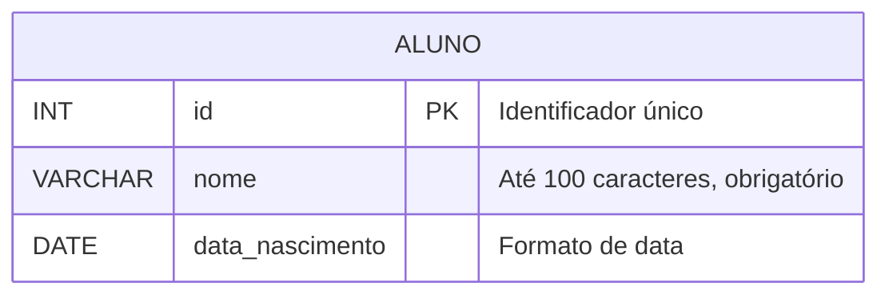

## 📚 TABELAS EM LINGUAGEM SQL

No contexto dos Sistemas de Gerenciamento de Banco de Dados Relacionais (SGBDR), a tabela é a estrutura fundamental de armazenamento e organização de dados. Para compreender uma tabela em SQL, é útil fazer uma analogia inicial com uma planilha eletrônica: assim como uma planilha, uma tabela organiza informações em linhas e colunas. No entanto, a tabela de banco de dados possui regras muito mais rígidas e estruturadas. Enquanto uma planilha permite que o usuário insira qualquer tipo de dado em qualquer célula, uma tabela em SQL exige que cada coluna tenha um propósito definido e um tipo de dado específico, garantindo a consistência e a integridade das informações armazenadas.

A finalidade principal de uma tabela é representar uma entidade do mundo real dentro do sistema. Por exemplo, em um sistema escolar, precisamos armazenar informações sobre os estudantes. Em vez de jogar esses dados em um arquivo de texto desestruturado, criamos uma tabela chamada "Aluno". Essa tabela servirá como o recipiente lógico onde cada linha representará um estudante único e cada coluna representará uma característica desse estudante, como nome, data de nascimento ou número de matrícula.

> 💡 **Dica:** Pense na tabela como um formulário de papel padronizado. Todos os formulários têm os mesmos campos, e as regras de preenchimento são as mesmas para todos.

Dominar a criação e a estruturação de tabelas é o primeiro passo essencial para qualquer profissional de tecnologia que deseje trabalhar com dados. Sem tabelas bem projetadas, o banco de dados se torna lento, propenso a erros e difícil de manter. Portanto, entender os componentes de uma tabela e como traduzi-los para a linguagem SQL não é apenas uma exigência acadêmica, mas uma competência prática de mercado.

---

## 🛠️ Construindo uma tabela SQL

Para construir uma tabela em SQL, é necessário compreender seus componentes principais:

1. **Nome da Tabela:** Deve ser único dentro do banco de dados e, por convenção, escrito no singular (ex: `Aluno`), representando a entidade.
2. **Colunas (Campos):** Definem os atributos da entidade. Cada coluna deve ter um nome e um **tipo de dado** associado. Os tipos mais comuns incluem:
   - `INT`: para números inteiros.
   - `VARCHAR(n)`: para textos de tamanho variável até 'n' caracteres.
   - `DATE`: para datas.
3. **Restrições (*Constraints*):** Regras aplicadas aos dados para garantir a integridade.
   - `PRIMARY KEY`: Identifica de forma única cada linha, impedindo duplicatas e valores nulos.
   - `NOT NULL`: Obriga o preenchimento do campo.
   - `FOREIGN KEY`: Cria o relacionamento entre duas tabelas.

> ⚠️ **Ponto de atenção:** Escolher o tipo de dado errado (ex: usar `VARCHAR` para um valor que será usado em cálculos matemáticos) pode causar erros de desempenho e lógica na aplicação.

A tradução desses conceitos para a linguagem SQL é feita através do comando `CREATE TABLE`. A sintaxe exige que, após o nome da tabela, abramos parênteses para listar as colunas, separadas por vírgula, definindo nome, tipo e restrições.

Veja o exemplo prático de uma tabela de alunos e sua representação visual:

```sql
CREATE TABLE Aluno (
    id INT PRIMARY KEY,             -- Coluna 'id': número inteiro, identificador único da linha.
    nome VARCHAR(100) NOT NULL,     -- Coluna 'nome': texto de até 100 caracteres, preenchimento obrigatório.
    data_nascimento DATE            -- Coluna 'data_nascimento': formato de data, preenchimento opcional.
);                                  -- O comando é finalizado com ponto e vírgula.
```


Neste exemplo, o `id` atua como a chave primária. O campo `nome` não pode ficar em branco (`NOT NULL`), evitando registros incompletos. A estrutura é clara, padronizada e pronta para receber dados.

---

## 🎯 Conclusão

Em síntese, as tabelas em SQL são os pilares sobre os quais toda a arquitetura de um banco de dados relacional é construída. Elas incorporam regras de negócio e garantias de integridade por meio de tipos de dados e restrições. A capacidade de modelar corretamente uma tabela e traduzi-la para o comando `CREATE TABLE` é o que separa um armazenamento de dados caótico de um sistema de informação confiável.

A reflexão que fica é que o tempo investido no planejamento da estrutura da tabela economiza horas de correção de erros no futuro. Com este conhecimento consolidado, o próximo passo natural é explorar como povoar essas tabelas com o comando `INSERT` e recuperar informações com o comando `SELECT`. A base está lançada.
