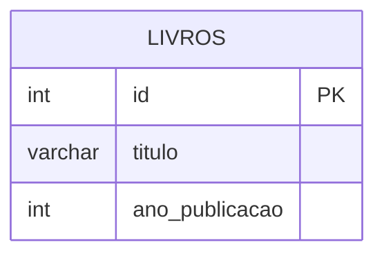

# 📚 CONSULTAS ATRAVÉS DO COMANDO SELECT

Em um mundo orientado por dados, os Bancos de Dados Relacionais atuam como o coração de aplicações modernas. No entanto, ter os dados armazenados é apenas metade do caminho; a verdadeira utilidade surge quando conseguimos extrair essas informações de forma precisa e rápida.

Para isso, utilizamos a **SQL** (Structured Query Language), o padrão universal de comunicação com bancos de dados relacionais. Dentro desse conjunto de comandos, o `SELECT` ocupa a posição de maior destaque. Sua finalidade principal é recuperar dados de uma ou mais tabelas, permitindo que o usuário especifique exatamente quais informações deseja visualizar, sem alterar o conteúdo original. Sem o `SELECT`, os dados permaneceriam estáticos e inacessíveis para análise ou tomada de decisão.

---

## 🛠️ Comando SELECT

O comando `SELECT` possui uma sintaxe declarativa: você descreve "o que" deseja obter, e o SGBD descobre "como" obtê-lo de forma eficiente. A estrutura mínima obrigatória envolve duas cláusulas: `SELECT` e `FROM`.

> 💡 **Dica:** A cláusula `SELECT` define **quais colunas** serão exibidas, enquanto a cláusula `FROM` define **de qual tabela** os dados serão extraídos.

### O Curinga Asterisco (*)
Se desejarmos visualizar todos os atributos, usamos o asterisco (`*`). Exemplo: `SELECT * FROM Livros`. 
> ⚠️ **Ponto de atenção:** O uso do `*` em ambientes de produção é desencorajado, pois consome recursos de rede e memória desnecessariamente ao trazer dados que não serão utilizados.

### Seleção Específica e Filtragem
Para uma abordagem profissional, liste apenas as colunas de interesse: `SELECT titulo, autor FROM Livros`. 

Para filtrar registros, utilizamos a cláusula `WHERE`, que avalia uma condição lógica para cada linha. Apenas as linhas que satisfazem a condição são retornadas. Exemplo: `SELECT titulo FROM Livros WHERE ano_publicacao > 2000`.

### Do MER para o SQL
Considere a entidade `Livro` em um Modelo Entidade-Relacionamento (MER). Ao traduzi-lo para o banco de dados físico, usamos o `CREATE TABLE`. O `SELECT` opera diretamente sobre essas colunas definidas:

```sql
-- Criação da tabela Livros baseada no MER
CREATE TABLE Livros (
    id INT PRIMARY KEY,          -- Identificador único (Chave Primária)
    titulo VARCHAR(150) NOT NULL,-- Nome do livro, campo obrigatório
    ano_publicacao INT           -- Ano de lançamento da obra
);
```



> 💡 **Dica de Boa Prática:** Sempre termine suas instruções com ponto e vírgula (`;`) e utilize identação para separar as cláusulas, garantindo legibilidade e manutenibilidade do código.

## 🏁 Conclusão
O comando `SELECT` é a ponte entre os dados brutos e o valor estratégico que eles geram. Dominar as cláusulas `SELECT`, `FROM` e `WHERE` é um requisito indispensável. Lembre-se: a eficiência está em selecionar apenas o necessário e aplicar filtros precisos. Esta aula é a fundação para operações avançadas como `ORDER BY`, funções de agregação (`COUNT`, `SUM`) e junções (`JOIN`) que você explorará nos próximos módulos. Pratique incessantemente!
