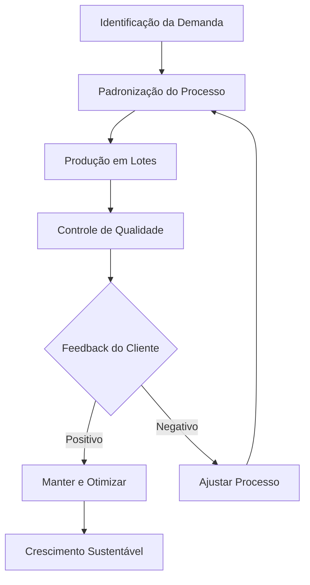

## 🏢 QUALIDADE E PRODUTIVIDADE

O empreendedorismo é frequentemente associado apenas à criação de uma empresa ou à busca por riqueza rápida. No entanto, a sustentabilidade de qualquer negócio depende de dois pilares operacionais fundamentais: qualidade e produtividade. 

Qualidade, neste contexto, não significa luxo ou perfeição inalcançável. Significa a capacidade de entregar um produto ou serviço que atenda consistentemente às expectativas do cliente. Significa também resolver o problema proposto de forma confiável. 

Produtividade é a relação direta entre os recursos utilizados e os resultados obtidos. Não se trata apenas de trabalhar mais horas. Trata-se de otimizar tempo, dinheiro e materiais para gerar maior valor com menos desperdício. 

Para o empreendedor iniciante, dominar esses conceitos é a diferença crítica entre um negócio que sobrevive ao primeiro ano e um que fracassa por esgotamento de recursos ou insatisfação do mercado.

> 💡 **Dicas práticas**
> - Defina o que "qualidade" significa para o seu cliente específico.
> - Meça o tempo gasto em cada tarefa principal do seu negócio.
> - Padronize as etapas repetitivas desde o primeiro dia.

> ⚠️ **Erros comuns de iniciantes**
> - Não confunda velocidade com produtividade.
> - Não pule etapas de planejamento para "agir rápido".
> - Não ignore feedbacks negativos dos primeiros clientes.

---

## ⚙️ Elementos e Aplicação Prática

O aprofundamento desses conceitos requer a compreensão de elementos práticos de gestão. 

1. **Padronização**: Processos padronizados garantem que o resultado final seja consistente, independentemente de quem execute a tarefa.
2. **Mensuração**: O que não é medido não pode ser melhorado. Indicadores como tempo de produção e custo por unidade fornecem base para decisões racionais.
3. **Melhoria Contínua**: Ajustar pequenos detalhes do processo regularmente para eliminar desperdícios sem grandes rupturas.

Ferramentas de apoio simples são fundamentais: checklists de verificação, cronogramas de produção e controle de estoque básico.

### 🔄 Ciclo de Melhoria Contínua

### 🍱 Exemplo Prático: Marmitas Fitness Artesanais

Considere um negócio de marmitas fitness. A **qualidade** se manifesta na consistência do sabor, na precisão das porções e na segurança alimentar. Se um cliente recebe uma refeição fria ou diferente do prometido, a confiança é quebrada.

A **produtividade** é aplicada na produção em lotes. O empreendedor cria um cardápio semanal fixo, compra ingredientes em quantidade para obter melhores preços e organiza a cozinha em estações de trabalho lógicas. O tempo para produzir dez marmitas é proporcionalmente menor do que para produzir uma unidade isolada. O desperdício é reduzido e o tempo de entrega é otimizado.

> 💡 **Dicas práticas**
> - Agrupe tarefas semelhantes para ganhar eficiência.
> - Negocie com fornecedores com base em um cardápio fixo.
> - Crie um checklist de higiene e embalagem para cada pedido.

> ⚠️ **Erros comuns de iniciantes**
> - Não cozinhe pedidos individuais sob demanda sem planejamento.
> - Não compre ingredientes sem um cardápio definido.
> - Não ignore a organização física do espaço de trabalho.

---

## 🎯 Conclusão: Superando Desafios Reais

A implementação efetiva enfrenta desafios. A principal barreira é a falsa economia de pular etapas de planejamento. Essa pressa resulta em retrabalho, que consome mais tempo e dinheiro do que a execução correta. Outro desafio é a resistência à mudança de processos ineficientes.

Superar esses obstáculos exige disciplina. É preciso tratar o negócio como um sistema que pode ser constantemente refinado. A produtividade bem aplicada protege a saúde mental do empreendedor, evitando o esgotamento por jornadas desorganizadas. 

O sucesso não é um evento isolado. É o resultado acumulado de pequenas decisões diárias que priorizam a eficiência operacional e a excelência na entrega de valor.
