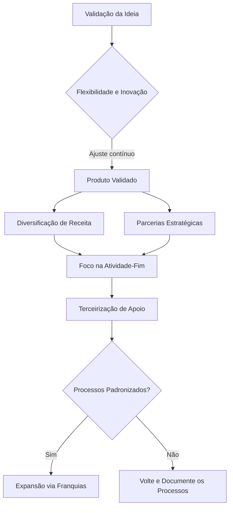

## 🎯 Empreender é Resolver Problemas

Empreender vai muito além de abrir uma empresa ou buscar enriquecimento rápido. Trata-se de um processo contínuo de identificação de problemas e criação de soluções viáveis no mercado. Muitos iniciantes acreditam que ter uma ideia brilhante é suficiente. No entanto, a realidade exige adaptação constante. A flexibilidade e a inovação atuam como pilares de sobrevivência, permitindo ajustar a rota conforme o feedback dos clientes.

Além da adaptação, o crescimento sustentável depende de estratégias estruturadas. A diversificação, as parcerias, a terceirização e as franquias são ferramentas essenciais para escalar um negócio. Cada uma possui um propósito claro. Compreender esses conceitos é vital para saber qual ferramenta utilizar em cada fase de maturidade do negócio, transformando o empreendedorismo em uma disciplina acessível e planejada.

## 🚀 Desenvolvimento: Estratégias na Prática

### 🔄 Flexibilidade e Inovação
Flexibilidade é a capacidade de alterar processos sem quebrar a estrutura do negócio. Inovação é encontrar maneiras melhores de atender ao cliente, não necessariamente criar tecnologia complexa. 
> 💡 **Dica prática:** Teste mudanças pequenas e mensuráveis antes de alterar todo o modelo de negócio.

### 📦 Diversificação de Receita
Consiste em adicionar produtos ou serviços complementares ao portfólio existente para reduzir riscos. 
> ⚠️ **Erro comum:** Diversifique apenas para mercados que tenham relação direta com sua competência central.

### 🤝 Parcerias Estratégicas
Ocorre quando duas empresas unem forças para obter benefício mútuo, compartilhando recursos e redes de contato.
> 💡 **Dica prática:** Formalize os acordos de parceria por escrito, mesmo que seja um negócio local pequeno.

### 🏢 Terceirização Inteligente
É a contratação de serviços externos para atividades que não são o foco principal (atividade-fim) do negócio.
> ⚠️ **Erro comum:** Nunca terceirize o controle de qualidade do seu produto principal ou o atendimento direto ao cliente.

### 🌐 Modelo de Franquias
Estratégia avançada onde terceiros utilizam sua marca e processos padronizados em troca de investimento e taxas.
> 💡 **Dica prática:** Só franqueie quando seus processos forem totalmente independentes da sua presença física.

### 📊 Fluxo de Crescimento Estratégico

## 🏁 Conclusão: Planejamento Supera a Sorte

Essas ferramentas são poderosas, mas apresentam desafios reais. A diversificação mal planejada dilui a marca. A terceirização errada gera perda de qualidade. O sucesso vem da escolha consciente da estratégia certa, no momento certo. Empreender é gerenciar recursos limitados para resolver problemas reais, passo a passo.
