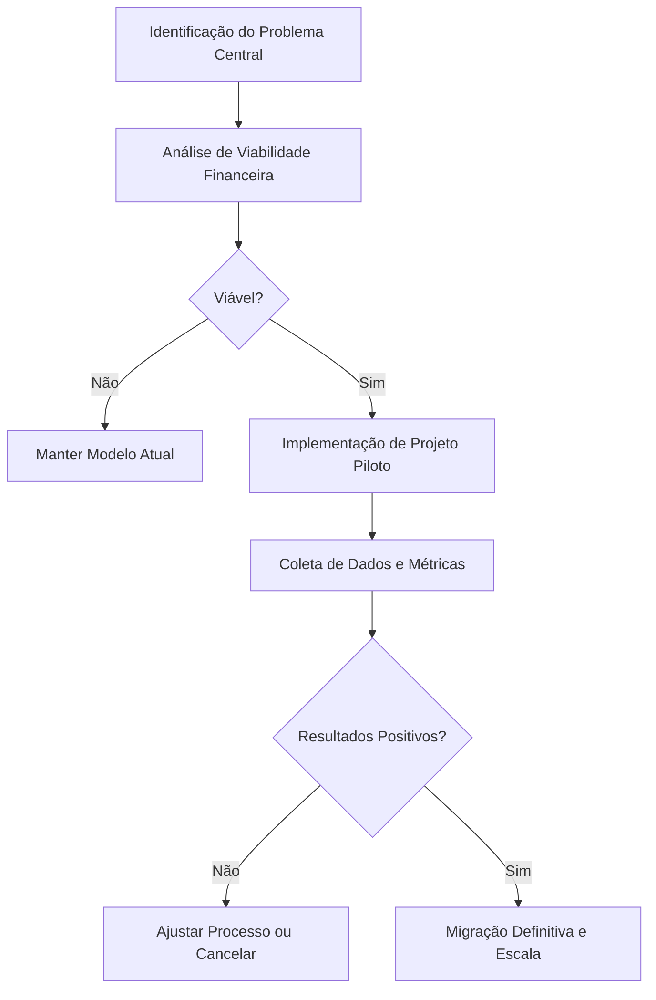

## 🎯 DESCONCENTRAÇÃO

O empreendedorismo é frequentemente associado à aglomeração em grandes centros urbanos. Muitos acreditam que o sucesso de um novo negócio depende exclusivamente de estar localizado em capitais ou regiões metropolitanas densas. Essa visão ignora uma estratégia fundamental: a **desconcentração**. 

No contexto do empreendedorismo, a desconcentração refere-se à distribuição estratégica de atividades, recursos ou processos decisórios para fora dos hubs tradicionais de negócios. Isso pode ocorrer de forma geográfica (transferir operações para cidades menores) ou organizacional (delegar autoridade para equipes distribuídas).

Compreender a desconcentração é um pilar fundamental na jornada de criação de um negócio. Ela desmistifica a ideia de que empreender exige grandes investimentos iniciais em infraestrutura física em locais de alto custo. Ao redistribuir recursos, o empreendedor ganha flexibilidade operacional. A empresa torna-se mais leve e adaptável. A desconcentração permite o acesso a novos mercados regionais, a redução de custos operacionais fixos e a oportunidade de captar talentos em regiões menos saturadas.

> 💡 **Dica prática:** Mapeie seus custos fixos atuais e compare com os custos de uma cidade de médio porte. Use planilhas simples para visualizar a economia potencial antes de tomar qualquer decisão.

> ⚠️ **Erro comum de iniciantes:** Não mude sua operação inteira de uma vez sem testar. Sempre inicie com um projeto piloto para validar a infraestrutura local e a produtividade da equipe.

## ⚙️ Desenvolvimento: Pilares e Aplicação

A implementação da desconcentração exige a observação de elementos fundamentais para evitar falhas operacionais.

1. **Análise de Viabilidade:** Mapeie todos os custos atuais e projete os custos no novo cenário (aluguel, impostos, salários, logística). A economia prevista deve superar os custos de transição.
2. **Infraestrutura Tecnológica:** A desconcentração só é viável com ferramentas digitais robustas. Sistemas de gestão em nuvem e protocolos de segurança da informação são indispensáveis.
3. **Gestão Autônoma:** A desconcentração falha se o empreendedor tentar microgerenciar à distância. Estabeleça metas claras e indicadores de desempenho objetivos. A equipe precisa de autonomia para resolver problemas locais.

### 🔄 Fluxo de Processo da Desconcentração

### 🏢 Exemplo Prático Detalhado

Imagine uma empresa de suporte e gestão digital para pequenos comércios, instalada em uma capital de alto custo. A empresa enfrenta aluguel caro e alta rotatividade de funcionários. O empreendedor decide aplicar a desconcentração geográfica para uma cidade de médio porte no interior.

O primeiro passo foi validar a conectividade local. O empreendedor iniciou com um projeto piloto: dois funcionários trabalharam remotamente do interior por três meses. A empresa mediu a produtividade e a satisfação dos clientes. Os dados mostraram que a produtividade aumentou 15%. 

Com essa validação, a mudança definitiva foi aprovada. O escritório na capital foi desativado. A empresa alugou um espaço menor e mais barato no interior, com internet de alta velocidade. A contratação focou em profissionais locais, que valorizaram a oportunidade sem precisar se mudar. O resultado foi uma redução de 30% nos custos fixos operacionais e uma queda drástica na rotatividade, aumentando a margem de lucro.

> 💡 **Dica prática:** Invista em softwares de gestão de tarefas assíncronas. Eles reduzem a necessidade de reuniões constantes e documentam o progresso do trabalho.

> ⚠️ **Erro comum de iniciantes:** Não subestime a qualidade da conexão de internet no novo local. Sempre contrate um link dedicado ou tenha um plano de contingência com internet móvel.

## 🏁 Conclusão e Reflexão

Em síntese, a desconcentração representa uma evolução madura no pensamento empreendedor. Ela substitui a busca por prestígio geográfico pela busca por eficiência operacional. O valor de um negócio não está no seu CEP, mas na qualidade da sua solução e na eficiência dos seus processos.

No entanto, os desafios reais não devem ser subestimados. A infraestrutura de conectividade em algumas regiões ainda é instável. A adaptação cultural de equipes acostumadas ao modelo presencial exige tempo e treinamento constante. A logística de distribuição física pode se tornar mais complexa se não for bem calculada.

Superar esses obstáculos exige planejamento prévio e uma liderança capaz de comunicar a visão com clareza. A desconcentração exige abandonar símbolos de status em favor de indicadores reais de saúde do negócio. O foco deve ser o fluxo de caixa, a satisfação do cliente e o bem-estar da equipe. 

A desconcentração não é uma solução mágica para negócios mal estruturados. Ela é um multiplicador de eficiência para negócios bem planejados. Ao fazer essa escolha com base em dados, o empreendedor constrói uma empresa sólida, preparada para crescer de forma sustentável.

