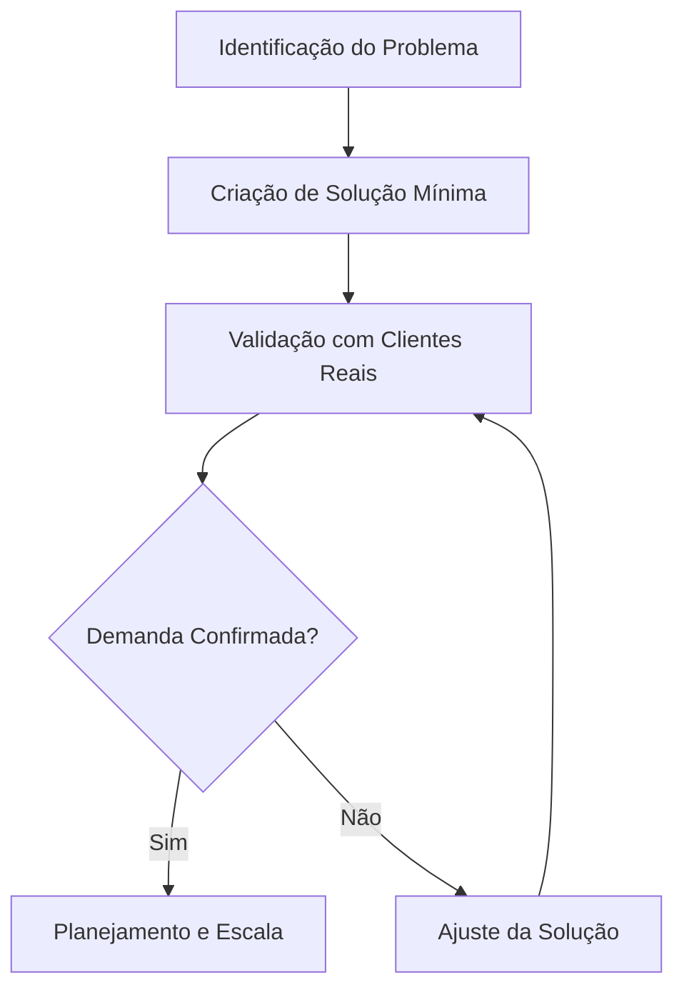

# 📚 INTRODUÇÃO AO EMPREENDEDORISMOS GLOBAL

O empreendedorismo é frequentemente associado, de forma reducionista, ao ato de abrir uma empresa ou à busca exclusiva por enriquecimento rápido. No entanto, em sua essência, a atividade empreendedora consiste na capacidade de identificar oportunidades, mobilizar recursos e criar valor para resolver problemas reais. 

Em uma economia globalizada, esse conceito ganha contornos complexos. A globalização caracteriza-se pela interconexão dos mercados, fluxo acelerado de informações e integração de cadeias de produção. Esse cenário impacta diretamente o pequeno produtor, o prestador de serviços local e o desenvolvedor de soluções digitais.

Compreender essa atividade é um pilar fundamental para criar negócios sustentáveis. A economia globalizada elimina barreiras geográficas, permitindo que uma solução local alcance consumidores distantes. Ao mesmo tempo, expõe o negócio a uma concorrência mais ampla. O empreendedor moderno deve unir o entendimento do seu ambiente imediato com as dinâmicas do mercado global.

## 🛠️ Desenvolvimento: Elementos e Prática

A atividade empreendedora exige a dominação de etapas fundamentais que garantam a viabilidade do negócio.

1. **Identificação do Problema:** Um negócio só existe se houver uma demanda não atendida.
2. **Proposta de Valor:** Explicação clara de por que o cliente escolheria sua solução.
3. **Validação:** Testar a hipótese com clientes reais, usando o mínimo de recursos.

### 🔄 O Ciclo de Validação

> 💡 **Dica prática:** Converse com 10 potenciais clientes antes de construir qualquer produto ou serviço.
> ⚠️ **Erro comum:** Não invista em estoque grande ou identidade visual cara antes de validar a demanda real.

Ferramentas contemporâneas facilitam esse processo. Planilhas de controle, pesquisas online e redes sociais permitem testar hipóteses com custo próximo de zero. Métricas simples, como a taxa de repetição de compra, substituem a intuição por dados concretos.

### 🏡 Exemplo Prático de Aplicação

Considere uma produtora artesanal de geleias no interior. Antigamente, seu mercado eram as feiras locais. Na economia globalizada, ela identifica que consumidores urbanos valorizam produtos naturais com narrativa autêntica. 

Ela não abre uma fábrica imediatamente. Ela cria uma página simples de vendas online e envia amostras para um grupo restrito em outra cidade, cobrando apenas o custo de produção. Ela valida a aceitação, o preço e os desafios logísticos. Com os dados em mãos, ela planeja a compra de insumos em escala e formaliza a empresa. Isso demonstra como uma solução local pode usar ferramentas digitais para superar barreiras geográficas.

Os desafios reais incluem escassez de recursos, concorrência global e obsolescência tecnológica. Superá-los depende exclusivamente de planejamento. Um plano de negócios enxuto força o empreendedor a antecipar problemas e calcular custos reais.

## 🎯 Conclusão e Próximos Passos

A atividade empreendedora em uma economia globalizada é um campo de oportunidades ampliado e de exigências elevadas. Empreender é um processo sistemático de identificação de problemas, criação de valor e validação contínua.

Os desafios do mercado global funcionam como filtros que premiam o planejamento e a resiliência. O empreendedor que testa hipóteses antes de gastar recursos está mais preparado para o sucesso do que aquele que age por intuição. 

A jornada empreendedora é uma construção metódica. Não existe fórmula mágica para enriquecimento rápido. Existe um método de trabalho que combina observação atenta, execução disciplinada e capacidade de ajuste. Essa mentalidade proativa é o ativo mais valioso para transformar desafios globais em soluções locais sustentáveis.
