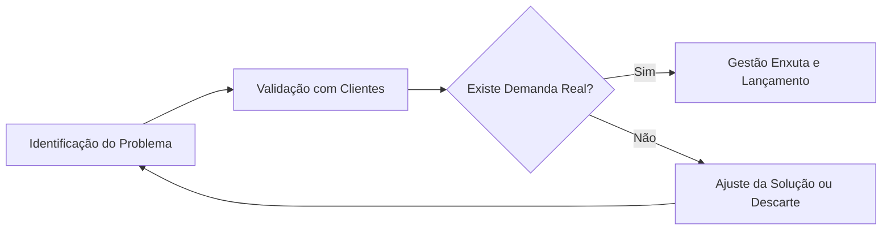

# 🌍 INTRODUÇÃO: O NOVO CENÁRIO DO TRABALHO

O mundo do trabalho passou por transformações profundas e aceleradas nas últimas décadas. O modelo tradicional de carreira, baseado em empregos de longa duração e estruturas hierárquicas rígidas, deu lugar a um ambiente dinâmico e flexível. Avanços tecnológicos e mudanças nas expectativas profissionais redefiniram as relações de trabalho. 

Nesse contexto, o empreendedorismo surge não como o ato burocrático de abrir uma empresa, mas como uma competência fundamental. Empreender significa identificar problemas não resolvidos, propor soluções viáveis e criar valor tangível. Compreender essa mudança de paradigma é essencial para que profissionais deixem de ser meros executores e passem a ser protagonistas de suas trajetórias, desenvolvendo autonomia, resiliência e visão estratégica.

## 🛠️ Elementos e Aplicações Práticas

Para aplicar o empreendedorismo no cenário atual, decomponha o processo em elementos acionáveis:

1. **Identificação de oportunidades:** Observe ativamente o ambiente. Um problema recorrente no cotidiano representa uma possibilidade concreta de negócio.
2. **Validação sistemática:** Teste sua solução com o público-alvo real antes de investir recursos. Isso evita desperdício de tempo e capital em projetos sem demanda.
3. **Gestão enxuta de recursos:** Utilize de forma criativa e eficiente o que já possui. Comece pequeno para controlar riscos e aprender rápido.
4. **Proposta de valor clara:** Defina por que o cliente escolheria sua solução em vez das alternativas existentes.

> 💡 **Dica prática:** Teste sua ideia com cinco pessoas reais antes de gastar qualquer dinheiro com estrutura ou identidade visual.

> ⚠️ **Erro comum de iniciante:** Não alugue um ponto comercial ou contrate funcionários antes de validar a demanda do seu produto.

O ciclo de validação pode ser representado pelo seguinte fluxo:

**Exemplo Prático:** Um profissional produz pães artesanais. Em vez de alugar uma cozinha industrial, ele produz pequenas quantidades em casa. Oferece amostras a vizinhos em troca de feedback sobre sabor e preço. Com base nas respostas, ele ajusta a receita. Apenas após confirmar que há compradores regulares, ele investe em embalagens profissionais e divulgação local. Esse caminho minimiza riscos e constrói uma base de clientes fiel.

## 🎯 Conclusão: Desafios e Mentalidade

O empreendedorismo não é um atalho para a riqueza rápida. É uma jornada de construção de valor que exige planejamento e persistência. Os desafios são reais: instabilidade de renda inicial, necessidade de autodisciplina e pressão por adaptação constante. 

Superar esses obstáculos requer educação continuada e uma rede de apoio sólida. Ao dominar a identificação de problemas, a validação e a gestão de recursos, você se prepara para atuar com mentalidade empreendedora em qualquer contexto. O sucesso não é garantido, mas a probabilidade de êxito aumenta drasticamente quando a ação é guiada por método e validação, não por impulso.
