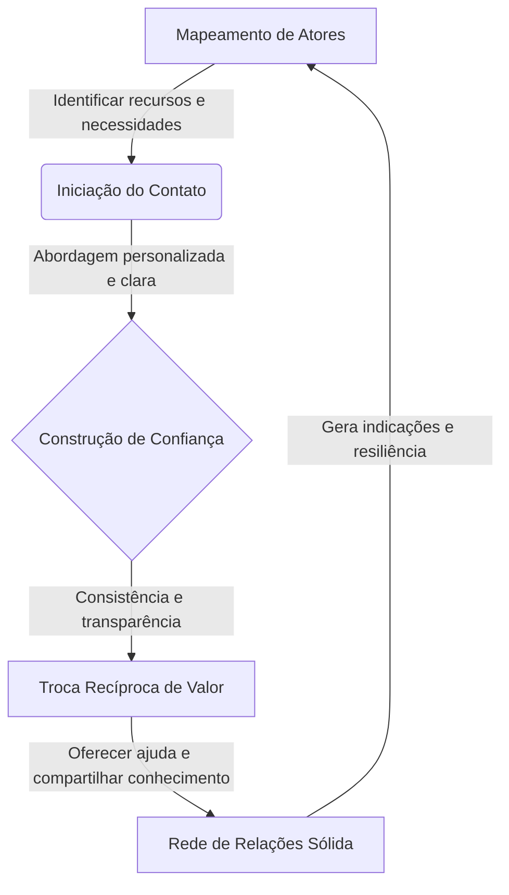

## 🌐 Introdução ao Conceito de Rede de Relações

O empreendedorismo é frequentemente retratado como um ato solitário de genialidade ou como a simples abertura formal de uma empresa. No entanto, a realidade dos negócios revela que o sucesso raramente depende apenas do esforço individual ou de capital financeiro robusto. Um dos pilares mais críticos na jornada de criação de um negócio é a **rede de relações**. 

Este conceito vai além da ideia superficial de fazer contatos em eventos sociais. Uma rede de relações no contexto empreendedor consiste no ecossistema estruturado de vínculos que um fundador constrói e mantém. Esses vínculos incluem mentores, parceiros estratégicos, fornecedores, clientes iniciais e pares do setor.

A importância deste pilar reside na sua capacidade de reduzir as incertezas inerentes a qualquer novo empreendimento. Quando um empreendedor inicia uma jornada, ele enfrenta lacunas de conhecimento, escassez de recursos e falta de credibilidade. Uma rede bem estruturada atua como uma ponte sobre essas lacunas, fornecendo acesso a informações privilegiadas e oportunidades de parceria. Dominar a dinâmica das relações é uma competência central que determina a resiliência e a capacidade de crescimento da organização.

## 🏗️ Estrutura, Aplicação e Desafios

### Elementos Fundamentais da Construção de Redes
Para transformar a rede de relações em uma ferramenta prática de gestão, é necessário compreender seus três elementos centrais:
1. **Mapeamento de atores**: Identificar sistematicamente pessoas e organizações que impactam ou são impactadas pelo negócio.
2. **Construção de confiança**: Exigir consistência, transparência e cumprimento rigoroso de promessas ao longo do tempo.
3. **Troca recíproca de valor**: Garantir que a relação não seja unilateral. Relações saudáveis são simbióticas.

> 💡 **Dicas práticas**
> - Mapeie seus contatos em uma planilha simples por categoria de recurso.
> - Envie atualizações periódicas e relevantes aos seus parceiros estratégicos.
> - Pergunte como você pode ajudar antes de solicitar qualquer recurso.

> ⚠️ **Erros comuns de iniciantes**
> - Não acumule centenas de contatos digitais sem criar vínculos profundos.
> - Não aborde pessoas experientes apenas para pedir favores sem oferecer retorno.
> - Não dependa excessivamente de um único contato para salvar o negócio.

### Passo a Passo para Estruturar sua Rede
O processo segue um fluxo lógico e acionável. A primeira etapa é a **identificação e categorização**. O empreendedor lista potenciais aliados, agrupando-os por tipo de recurso (conhecimento técnico, acesso a canais, validação). A segunda etapa é a **iniciação do contato**. A abordagem deve ser personalizada e focada em como o empreendedor pode contribuir para o outro. A terceira etapa é a **nutrição contínua**. Relações comerciais exigem manutenção ativa, com compartilhamento de informações relevantes e oferecimento de ajuda espontânea.

### Exemplo Prático de Aplicação
Considere uma marcenaria artesanal local que produz móveis sustentáveis. O fundador mapeia sua rede em quatro grupos: fornecedores de madeira certificada, associação de moradores, um designer de interiores autônomo e outros artesãos da região. Para nutrir essa rede, o marceneiro doa um banco reparado para a praça local. A associação divulga seu trabalho, gerando credibilidade. Ele compartilha dicas de acabamento com outros artesãos, que o indicam quando recebem pedidos extras. O designer, confiando no prazo do marceneiro, especifica seus móveis em projetos de clientes. Essa rede gera fluxo de trabalho sem investimento em publicidade tradicional.

## 🎯 Conclusão e Reflexões sobre a Jornada

Em síntese, a rede de relações constitui a espinha dorsal invisível que sustenta a operação e o crescimento de um novo negócio. Ela requer uma abordagem metódica baseada na identificação estratégica, na construção paciente de confiança e no compromisso com a reciprocidade. 

Os desafios para manter essa rede são significativos. Exige tempo, autenticidade e a humildade de reconhecer que o sucesso coletivo é mais robusto que o isolamento individual. Ignorar a construção de redes é escolher enfrentar os obstáculos do mercado com recursos limitados.

O fechamento realista é que uma rede sólida não produz resultados imediatos. É um investimento de médio a longo prazo. Os frutos aparecem na forma de uma ligação que resolve um problema crítico ou de um conselho que evita um erro custoso. O empreendedor deve começar a plantar essas sementes hoje, com foco em oferecer valor genuíno.

