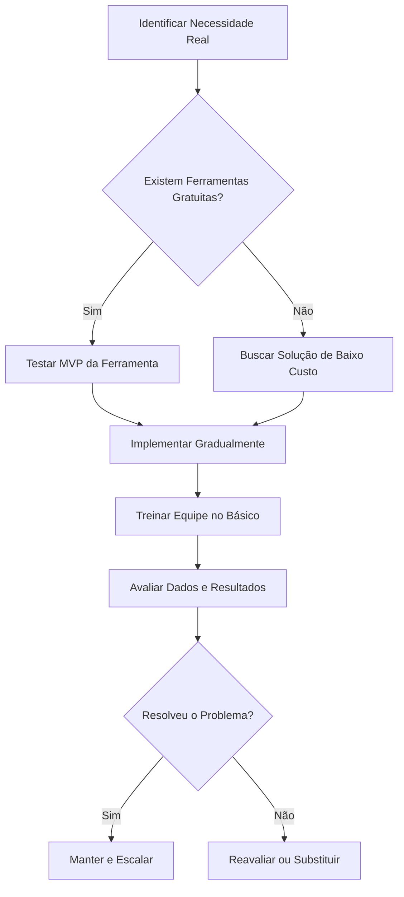

# 🚀 Introdução ao Uso de Softwares no Empreendedorismo

O empreendedorismo moderno está intrinsecamente ligado à capacidade de organizar recursos, identificar oportunidades e entregar valor de maneira eficiente. Neste contexto, a definição e as técnicas de utilização de softwares deixam de ser assuntos exclusivos da área de tecnologia da informação e tornam-se pilares fundamentais para a gestão de qualquer negócio. Software, em sua essência, é um conjunto de instruções, dados e programas que permitem a um dispositivo computacional executar tarefas específicas. No ambiente empreendedor, essa definição se amplia de forma prática: o software é uma ferramenta digital projetada para automatizar processos, organizar informações e facilitar a tomada de decisões baseadas em dados concretos.

Muitos iniciantes no empreendedorismo acreditam, equivocadamente, que utilizar software significa necessariamente desenvolver um aplicativo complexo ou contratar sistemas caros e sofisticados desde o primeiro dia de operação. Essa visão distorcida gera desperdício de recursos financeiros e paralisia na tomada de decisões. A realidade é que empreender com tecnologia significa, antes de tudo, saber escolher e aplicar a ferramenta digital certa para resolver um problema real do negócio. Seja uma planilha eletrônica para controlar o fluxo de caixa de uma pequena loja de artesanato, um aplicativo de mensagens para agendar consultas em um serviço local, ou um sistema de gestão de relacionamento para uma solução digital, o software deve servir ao propósito do negócio, e não o contrário.

A importância deste tema na jornada de criação de um negócio reside na escalabilidade e na organização estrutural. Um negócio que depende exclusivamente de processos manuais e análogos tende a encontrar um teto de crescimento rapidamente. Erros humanos, perda de informações críticas e lentidão nas respostas aos clientes são sintomas comuns da falta de ferramentas digitais adequadas. Portanto, compreender o que é software e como utilizá-lo de forma estratégica permite ao empreendedor estruturar uma operação mais robusta, reduzir custos operacionais e liberar tempo para atividades verdadeiramente estratégicas.

## 🛠️ Desenvolvimento: Conceitos e Técnicas de Utilização

Para aplicar softwares de maneira eficaz no empreendedorismo, é necessário dominar conceitos básicos e seguir técnicas estruturadas de utilização. O primeiro passo é compreender as categorias de software mais relevantes para a gestão inicial de um negócio. As ferramentas de produtividade e organização formam a base operacional. Os sistemas de gestão financeira permitem o controle rigoroso de entradas e saídas. As ferramentas de relacionamento com o cliente ajudam a organizar contatos e histórico de interações. Por fim, as plataformas de validação e presença digital são essenciais para testar ideias no mercado com baixo investimento.

A técnica de utilização desses recursos deve seguir um método progressivo, evitando a armadilha da complexidade prematura. A primeira técnica é o mapeamento rigoroso de necessidades. Antes de buscar qualquer ferramenta, o empreendedor deve documentar qual problema específico deseja resolver. A segunda técnica é a seleção baseada no princípio do Mínimo Produto Viável (MVP) aplicado às ferramentas. Isso significa começar com soluções gratuitas ou de baixo custo que atendam à necessidade central.

> 💡 **Dica prática:** Mapeie o problema real antes de buscar a ferramenta. Não compre um sistema caro para resolver um problema que uma planilha gratuita já resolve.
> ⚠️ **Erro comum:** Contratar softwares complexos no primeiro mês de operação. Valide a necessidade com ferramentas simples antes de investir recursos financeiros.

A terceira técnica é a implementação gradual e o treinamento básico. Introduzir um novo software exige adaptação cultural e operacional. O ideal é testar a ferramenta em um pequeno processo antes de expandir seu uso para toda a operação. A quarta técnica é a avaliação contínua de dados e segurança. O software deve gerar informações acionáveis e proteger os dados do negócio.

Um exemplo prático detalhado ilustra essa aplicação. Considere um negócio social de entrega de cestas de alimentos saudáveis. Inicialmente, os pedidos eram anotados em cadernos físicos, gerando atrasos e confusão nos pagamentos. Ao aplicar as técnicas, o primeiro passo foi o mapeamento: o problema real era a desorganização dos pedidos. Em vez de contratar um sistema caro de logística, o empreendedor aplicou o princípio do MVP. Ele selecionou uma ferramenta gratuita de formulários online para receber os pedidos e uma planilha eletrônica na nuvem para registrar pagamentos e rotas. A implementação foi gradual, começando com cinco clientes, até processar trinta pedidos semanais com zero atrasos e total clareza financeira.

## 🎯 Conclusão e Reflexão sobre os Desafios

Em síntese, a definição de software no contexto do empreendedorismo vai muito além do código de programação. Trata-se de uma ferramenta estratégica de organização, automação de tarefas repetitivas e suporte à tomada de decisão baseada em fatos. As técnicas de utilização, quando aplicadas com disciplina e método, transformam a tecnologia em uma aliada poderosa para o crescimento.

Os desafios reais na adoção dessas ferramentas são tangíveis. O custo cumulativo de assinaturas mensais, a curva de aprendizado inicial e a natural resistência humana à mudança de processos estabelecidos são barreiras comuns. Pequenos negócios frequentemente caem na armadilha de adquirir softwares complexos na esperança ilusória de que a ferramenta, por si só, resolva problemas profundos de gestão. Superar esses desafios exige planejamento prévio e realismo sobre o tamanho atual do negócio e o orçamento disponível.

O fechamento realista desta jornada é claro. Empreender com eficiência não requer as ferramentas mais caras ou sofisticadas do mercado. Requer o uso inteligente e disciplinado das ferramentas adequadas no momento certo. O sucesso na utilização de softwares é medido pela capacidade do empreendedor de alinhar esses recursos aos objetivos reais e mensuráveis da empresa.
