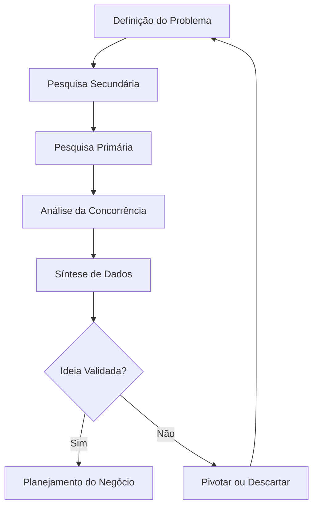

# 📌 Introdução à Análise de Mercado no Empreendedorismo
Muitos iniciantes no empreendedorismo acreditam que ter uma ideia inovadora é suficiente para construir um negócio de sucesso. Essa visão romantizada ignora um pilar fundamental da jornada empreendedora: a análise de mercado. Empreender não se resume a abrir uma empresa, registrar uma marca ou buscar enriquecimento rápido. Trata-se de identificar um problema real e oferecer uma solução viável que pessoas estejam dispostas a pagar para consumir. A análise de mercado é o processo sistemático de coletar, interpretar e avaliar informações sobre o ambiente onde o negócio pretende atuar. Ela responde a perguntas críticas e objetivas. Quem são os clientes potenciais? Quem já oferece soluções semelhantes? Quais são as barreiras de entrada e as tendências do setor? Sem essa investigação, o empreendedor navega às cegas, expondo seus recursos financeiros e pessoais a riscos desnecessários e evitáveis.

A análise de mercado transforma suposições subjetivas em dados concretos e acionáveis. Ela valida a demanda antes que grandes investimentos em estrutura, estoque ou marketing sejam realizados. Portanto, compreender e aplicar esse conceito não é uma etapa burocrática opcional ou um mero formalismo para atrair investidores. É a base sobre a qual qualquer modelo de negócio sustentável deve ser construído. Ignorar essa fase é a principal causa de falência precoce em novos empreendimentos, pois leva à criação de produtos que ninguém deseja comprar. O empreendedorismo responsável exige humildade para questionar suas próprias certezas e disciplina para buscar evidências no mundo real.

## 🔍 Conceitos, Passos e Aplicação Prática
A análise de mercado estrutura-se em três eixos principais de investigação: o público-alvo, a concorrência e o ambiente de negócios. O público-alvo representa o grupo específico de consumidores com necessidades que o seu produto ou serviço pretende atender. Definir esse grupo vai muito além de dados demográficos básicos como idade, gênero ou localização geográfica. Envolve compreender hábitos de consumo, dores específicas, desejos não atendidos, valores pessoais e capacidade financeira real. A concorrência engloba todas as empresas ou soluções que disputam a atenção e o dinheiro do mesmo público. Isso inclui concorrentes diretos, que oferecem exatamente o mesmo produto ou serviço, e concorrentes indiretos, que resolvem o mesmo problema do cliente de uma forma completamente diferente. O ambiente de negócios abrange fatores externos que o empreendedor não controla, mas que impactam a operação. Isso inclui legislação vigente, tendências tecnológicas, condições econômicas locais e mudanças culturais.

O processo de análise segue um passo a passo lógico e progressivo, conforme ilustrado no fluxo abaixo:

Uma ferramenta conceitual útil nesta etapa é a matriz de avaliação de forças, fraquezas, oportunidades e ameaças. Ela organiza as informações internas e externas em um único quadro visual. As forças e fraquezas avaliam a capacidade interna do empreendedor, como habilidades técnicas e disponibilidade de capital. As oportunidades e ameaças avaliam o ambiente externo, como a chegada de um novo concorrente ou uma mudança na legislação local. O uso dessa matriz força o empreendedor a olhar para o negócio de forma equilibrada, evitando o otimismo excessivo.

> 💡 **Dicas práticas**
> - Converse com pelo menos 30 potenciais clientes antes de gastar qualquer dinheiro.
> - Use questionários digitais gratuitos para ampliar o alcance da sua pesquisa primária.
> - Anote todas as objeções que os clientes levantarem sobre sua ideia.

> ⚠️ **Erros comuns de iniciantes**
> - Não gaste dinheiro com logotipo ou site antes de validar a demanda real.
> - Não ignore os concorrentes indiretos que resolvem o mesmo problema de forma diferente.
> - Não manipule os dados da pesquisa para que eles se encaixem na sua ideia inicial.

Para ilustrar, considere o exemplo prático de um empreendedor que deseja iniciar um serviço de entrega de marmitas fitness em um bairro residencial específico. A definição do problema é a falta de opções de alimentação saudável, acessível e prática para trabalhadores locais que não têm tempo de cozinhar durante a semana. Na pesquisa secundária, ele descobre que o bairro possui um alto índice de novas academias e pequenos escritórios de tecnologia. Na pesquisa primária, ele aborda cinquenta pessoas na porta de uma academia local e aplica um questionário rápido. Ele descobre que a maioria reclama do preço elevado e da falta de variedade dos serviços de entrega atuais. Na análise da concorrência, ele identifica dois restaurantes tradicionais que entregam na região, mas nota que nenhum oferece um plano de assinatura semanal com cardápio personalizado e informações nutricionais detalhadas. A síntese desses dados revela uma oportunidade clara e validada: oferecer um serviço de assinatura de marmitas fitness com preço competitivo, foco em variedade e transparência nutricional, preenchendo uma lacuna que os concorrentes atuais ignoram completamente.

## 🎯 Conclusão: Desafios Reais e a Necessidade do Planejamento
A análise de mercado é uma ferramenta poderosa, mas sua aplicação prática apresenta desafios reais e significativos. O principal obstáculo cognitivo é o viés de confirmação. Neste cenário, o empreendedor inconscientemente busca apenas dados que confirmam sua ideia inicial, ignorando ou minimizando sinais de alerta que contradizem suas expectativas. Outro desafio comum é a limitação de recursos. Iniciantes muitas vezes não possuem orçamento financeiro ou tempo para contratar empresas especializadas em pesquisa de mercado. No entanto, a falta de recursos financeiros não justifica a ausência total de análise. Métodos de pesquisa primária de baixo custo, como conversas diretas, observação de campo e questionários digitais simples, são altamente eficazes quando bem planejados e executados com rigor.

É fundamental aceitar que os dados coletados podem invalidar a ideia original do negócio. Quando isso acontece, o empreendedor não deve insistir no erro por apego emocional. Ele deve pivotar, ou seja, ajustar a solução, o preço ou o público-alvo com base nas evidências concretas coletadas. A análise de mercado não garante o sucesso absoluto do negócio, pois fatores externos imprevisíveis e a execução operacional sempre influenciarão o resultado final. Contudo, ela reduz drasticamente o risco de fracasso por cegueira estratégica e falta de planejamento. Planejar com base em dados reais e validados é o que separa um hobby arriscado e dispendioso de um empreendimento com potencial real de sustentabilidade, crescimento e impacto positivo na comunidade.
