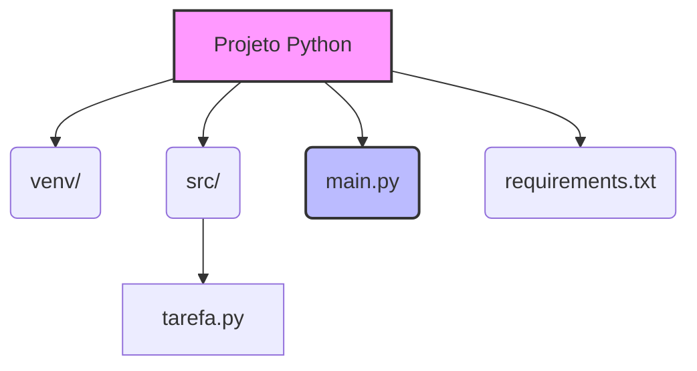

# 🐍 Criando de Projetos em Python

Quando iniciamos os estudos em lógica de programação, é comum escrevermos scripts únicos e lineares. No entanto, ao transicionarmos para o desenvolvimento profissional, essa abordagem se torna insustentável. Criar um projeto em Python vai muito além de salvar um arquivo `.py`. Envolve isolar dependências, estruturar pastas de forma lógica e aplicar princípios de Orientação a Objetos para que o código seja modular e reutilizável.

> 💡 **Dica:** Um projeto organizado previne o "código espaguete", onde variáveis, funções e regras de negócio estão misturadas, facilitando a leitura e a manutenção.

Dominar essa estrutura é o divisor de águas entre criar scripts soltos e desenvolver sistemas robustos, estabelecendo uma base sólida para controle de versão e testes automatizados.

---

# ⚙️ Estruturando o Projeto na Prática

## 1. [O Ambiente Virtual (venv)](https://docs.python.org/pt-br/3/library/venv.html)
O primeiro passo é a criação de um ambiente virtual. Imagine-o como uma caixa isolada onde seu projeto vive, garantindo que as bibliotecas instaladas não interfiram em outros projetos.

> ⚠️ **Ponto de atenção:** A pasta do ambiente virtual (`venv/`) **nunca** deve ser enviada para repositórios de código (como o GitHub). Ela deve ser recriada por cada desenvolvedor localmente.

Para criar, use o comando: `python -m venv venv`.  
Para ativar: `source venv/bin/activate` (Linux/macOS) ou `venv\Scripts\activate` (Windows).

---

## 2. A Estrutura de Pastas
Um padrão amplamente adotado na comunidade Python é:
- `venv/`: Ambiente virtual isolado.
- `src/`: Pasta que contém o código fonte real (módulos e classes).
- `main.py`: Arquivo principal que orquestra a execução.
- `requirements.txt`: Arquivo que lista as dependências externas.



---

## 3. Aplicando Orientação a Objetos no Projeto
A modularidade é um pilar da Orientação a Objetos. Vamos criar um exemplo prático aplicando o Princípio da Responsabilidade Única.

```python
# Arquivo: src/tarefa.py
class Tarefa:
    def __init__(self, titulo: str, descricao: str):
        self.titulo = titulo          # Atributo que armazena o nome da tarefa
        self.descricao = descricao    # Atributo que armazena os detalhes da tarefa
        self.concluida = False        # Atributo de estado, inicia sempre como False

    def marcar_concluida(self):
        # Método que altera o estado interno do objeto para verdadeiro
        self.concluida = True

    def exibir_detalhes(self):
        # Método que retorna uma string formatada com base no estado atual
        status = "Concluída" if self.concluida else "Pendente"
        return f"Tarefa: {self.titulo} | Status: {status}"
```

No arquivo principal, importamos essa classe e a utilizamos:

```python
# Arquivo: main.py
from src.tarefa import Tarefa  # Importa a classe Tarefa do módulo na pasta src

def main():
    # Cria uma instância (objeto) da classe Tarefa com dados iniciais
    minha_tarefa = Tarefa("Estudar Python", "Revisar criação de projetos")
    
    # Chama o método para exibir o estado inicial do objeto recém-criado
    print(minha_tarefa.exibir_detalhes())
    
    # Altera o estado do objeto chamando seu método específico de modificação
    minha_tarefa.marcar_concluida()
    
    # Verifica o novo estado, demonstrando o encapsulamento do comportamento
    print(minha_tarefa.exibir_detalhes())

if __name__ == "__main__":
    main() # Executa a função principal apenas se este arquivo for o ponto de entrada
```

> 💡 **Dica:** O bloco `if __name__ == "__main__":` garante que o código só seja executado quando o arquivo for chamado diretamente, evitando efeitos colaterais ao importar a classe em outros contextos.

---

# 🎯 Conclusão

A criação de um projeto em Python é a fundação do desenvolvimento profissional. Ambientes virtuais garantem isolamento; a estrutura de pastas estabelece uma arquitetura navegável; e a Orientação a Objetos transforma scripts frágeis em sistemas modulares e escaláveis. Dominar esses conceitos prepara o terreno para práticas avançadas e diferencia um programador iniciante de um engenheiro de software em formação.
