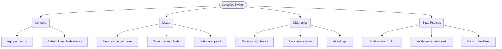

# MAPA MENTAL
Aqui está o mapa mental convertido para o formato `graph TD` (fluxograma hierárquico). 

Esta estrutura utiliza apenas recursos básicos e maduros do Mermaid, garantindo que a renderização seja **idêntica e sem erros** no GitHub, Obsidian, Notion ou qualquer outro visualizador.

### Por que este formato é mais seguro?
1. **Sem caracteres especiais no ID**: Os nós usam identificadores simples (ex: `C1`, `D2`), evitando conflitos de sintaxe.
2. **Hierarquia clara**: O uso de `-->` cria uma árvore visual que substitui perfeitamente a função de um mapa mental.
3. **Compatibilidade retroativa**: Funciona em versões do Mermaid.js de até 5 anos atrás, eliminando qualquer risco de "Parse error".

Se precisar ajustar algum termo ou adicionar mais um ramo a este gráfico, é só solicitar!
