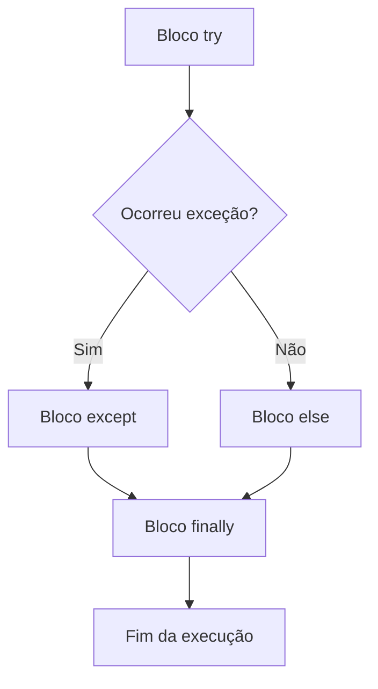

## 🛡️ Introdução ao Tratamento de Exceções

O tratamento de exceções é fundamental no desenvolvimento de software robusto. Uma exceção é um evento que ocorre durante a execução do programa. Esse evento interrompe o fluxo normal das instruções. Em Python, exceções são objetos que representam erros de tempo de execução.

É crucial diferenciar erros de sintaxe de exceções. Erros de sintaxe impedem o programa de iniciar. Exceções de tempo de execução ocorrem durante a operação do sistema. Um exemplo comum é tentar dividir um número por zero. Outro exemplo é tentar acessar um índice inexistente em uma lista.

Sem tratamento, o programa encerra abruptamente. Isso gera uma experiência ruim para o usuário final. O tratamento de exceções permite capturar esses eventos de forma controlada. O sistema pode exibir uma mensagem clara ou tentar uma ação alternativa.

## ⚙️ Desenvolvimento e Sintaxe Python

A sintaxe básica utiliza o bloco `try`. O bloco `try` contém o código que pode gerar um erro. O bloco `except` define a ação corretiva. O Python executa o bloco `try` primeiro. Se ocorrer uma exceção, o restante do bloco `try` é ignorado. O controle passa imediatamente para o bloco `except` correspondente.

> 💡 **Dicas de código**
> Especifique sempre o tipo de exceção (ex: `except ValueError:`). Isso evita capturar erros inesperados e mascarar bugs no código.

O bloco `else` é opcional. Ele executa apenas se nenhuma exceção ocorrer no bloco `try`. O bloco `finally` também é opcional. Ele executa sempre, independentemente de ocorrer uma exceção. Use-o para liberar recursos, como fechar arquivos.



### Exemplo Prático: Conta Bancária

Considere a classe `ContaBancaria`. Ela possui um atributo `saldo`. O método `sacar` valida as regras de negócio.

```python
class ContaBancaria:
    def __init__(self, titular, saldo_inicial):
        self.titular = titular
        self.saldo = saldo_inicial

    def sacar(self, valor):
        if valor < 0:
            raise ValueError("O valor do saque deve ser positivo.")
        if valor > self.saldo:
            raise ValueError("Saldo insuficiente para o saque.")
        
        self.saldo -= valor
        return self.saldo
```

O código acima lança exceções manualmente com `raise`. Vamos consumir essa classe com tratamento de exceções.

```python
conta = ContaBancaria("Ana", 500.0)

try:
    print(f"Saldo inicial: R$ {conta.saldo}")
    conta.sacar(600.0)
    print("Saque realizado com sucesso.")
except ValueError as erro:
    print(f"Erro na operação: {erro}")
else:
    print("Transação concluída sem erros.")
finally:
    print("Fim da operação de saque.")
```

> ⚠️ **Erros comuns de sintaxe**
> Não use `except:` vazio. Ele captura todas as exceções, incluindo `KeyboardInterrupt`, impedindo a interrupção do programa pelo usuário.

Além das exceções nativas, o Python permite criar exceções personalizadas. Basta herdar da classe `Exception`.

```python
class SaldoInsuficienteError(Exception):
    pass
```

Isso torna o tratamento de erros mais semântico e legível.

## 🎯 Conclusão e Boas Práticas

O tratamento de exceções protege o software contra falhas inesperadas. No entanto, o uso incorreto gera novos problemas. Sempre especifique o tipo de exceção. Capture apenas as exceções que você sabe como tratar.

Não use tratamento de exceções para controlar o fluxo lógico normal do programa. Valide os dados antes de executar a operação principal. Sempre registre a mensagem de erro ou tome uma ação corretiva. O uso das palavras-chave deve ser intencional.

Em resumo, o tratamento de exceções garante a resiliência do código. Ele transforma falhas catastróficas em eventos gerenciáveis. Aplique esses conceitos nos seus projetos de Orientação a Objetos.
