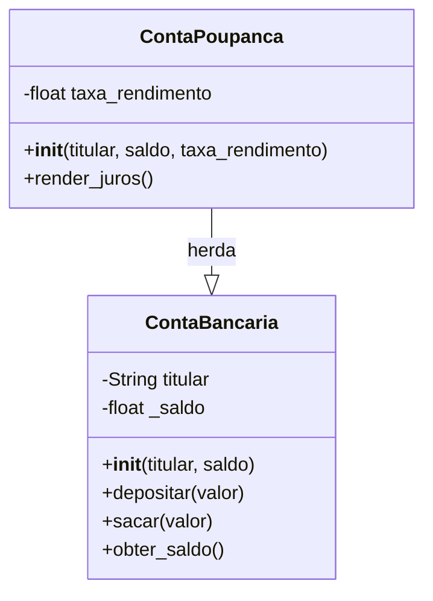

# 🏦 Herança e Encapsulamento em Python

## 📌 Introdução
A programação orientada a objetos organiza o código em classes. Uma classe define atributos e comportamentos. A herança permite que uma nova classe reutilize o código de uma classe existente. A classe existente é a classe pai. A nova classe é a classe filha. Isso evita a repetição de código. O encapsulamento protege os dados internos de um objeto. Ele restringe o acesso direto aos atributos. O acesso ocorre apenas por métodos específicos. Isso garante a integridade dos dados. Juntos, esses conceitos criam sistemas seguros e fáceis de manter.

## ⚙️ Desenvolvimento e Sintaxe
A herança em Python usa parênteses na definição da classe. A sintaxe é `class ClasseFilha(ClassePai):`. A classe filha herda atributos e métodos da classe pai. O método `__init__` da classe pai é chamado com `super().__init__()`. Isso inicializa os atributos herdados corretamente.

O encapsulamento em Python usa convenções de nomenclatura. Um underline inicial (`_atributo`) indica um atributo protegido. O programador não deve acessá-lo diretamente fora da classe. Dois underlines iniciais (`__atributo`) indicam um atributo privado.



> 💡 **Dicas de código**
> Use `super().__init__()` para reutilizar a inicialização da classe pai. Chame métodos existentes (como `depositar`) dentro de novos métodos para manter a validação centralizada.

> ⚠️ **Erros comuns de sintaxe**
> Esquecer o parâmetro `self` nos métodos causa `TypeError`. Acessar `__atributo` diretamente fora da classe gera `AttributeError` devido ao name mangling.

## 💻 Exemplo Prático: Sistema Bancário
```python
class ContaBancaria:
    def __init__(self, titular, saldo):
        self.titular = titular
        self._saldo = saldo

    def depositar(self, valor):
        self._saldo += valor

    def sacar(self, valor):
        if valor <= self._saldo:
            self._saldo -= valor
            return True
        return False

class ContaPoupanca(ContaBancaria):
    def __init__(self, titular, saldo, taxa_rendimento):
        super().__init__(titular, saldo)
        self.taxa_rendimento = taxa_rendimento

    def render_juros(self):
        rendimento = self._saldo * self.taxa_rendimento
        self.depositar(rendimento)
```
A classe `ContaBancaria` define a estrutura base. O atributo `_saldo` é protegido. A classe `ContaPoupanca` herda de `ContaBancaria`. Ela adiciona `taxa_rendimento`. O método `render_juros` usa o método herdado `depositar`.

## 🎯 Conclusão
A herança promove a reutilização de código. O encapsulamento garante a segurança dos dados. Evite acessar atributos protegidos diretamente. Sempre utilize os métodos fornecidos pela classe. Um erro comum é esquecer a chamada ao `super().__init__()`. Use herança apenas para relações de "é um". Construa código robusto e profissional.
