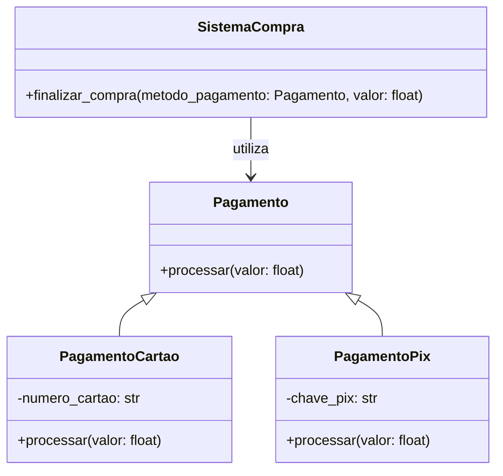

# 📘 Introdução ao Polimorfismo

O polimorfismo é um pilar fundamental da programação orientada a objetos. O termo técnico significa "muitas formas". Na prática, ele permite que objetos de classes diferentes respondam à mesma chamada de método. Cada objeto executa a ação de maneira específica à sua própria classe.

Imagine um sistema de pagamentos em uma plataforma de e-commerce. O sistema precisa processar diferentes métodos de pagamento. Sem o polimorfismo, o código exigiria múltiplas estruturas condicionais. Com o polimorfismo, o sistema trata todos os pagamentos de forma uniforme. O código principal chama apenas o método `processar`.

> 💡 **Dica de código:** O polimorfismo elimina a necessidade de cadeias longas de `if/elif` para verificar o tipo do objeto.

## ⚙️ Desenvolvimento e Sintaxe Python

O polimorfismo em Python ocorre principalmente por meio da sobrescrita de métodos. Uma classe base define um método genérico. As classes derivadas substituem esse método com sua própria lógica interna.

```python
class Pagamento:
    def processar(self, valor: float) -> None:
        # Força a implementação nas subclasses
        raise NotImplementedError("Método processar deve ser implementado nas subclasses.")
```

Agora, criamos as classes específicas que herdam da classe base.

```python
class PagamentoCartao(Pagamento):
    def __init__(self, numero_cartao: str):
        # Define o número do cartão
        self.numero_cartao = numero_cartao

    def processar(self, valor: float) -> None:
        # Processa a transação na operadora
        print(f"Processando cartão {self.numero_cartao} no valor de R$ {valor:.2f}.")

class PagamentoPix(Pagamento):
    def __init__(self, chave_pix: str):
        # Define a chave Pix
        self.chave_pix = chave_pix

    def processar(self, valor: float) -> None:
        # Gera o código de resposta Pix
        print(f"Gerando QR Code Pix para a chave {self.chave_pix} no valor de R$ {valor:.2f}.")
```

A função orquestradora utiliza o polimorfismo para processar qualquer pagamento.

```python
def finalizar_compra(metodo_pagamento: Pagamento, valor: float) -> None:
    # Inicia o fluxo de compra
    print("Iniciando finalização da compra.")
    # Chama o método polimórfico
    metodo_pagamento.processar(valor)
    # Finaliza o fluxo
    print("Compra finalizada com sucesso.")
```

> ⚠️ **Erros comuns de sintaxe:** Esquecer o parâmetro `self` no método da subclasse causará um `TypeError`. Manter a assinatura idêntica à classe base é obrigatório.

### 📊 Diagrama de Classes



## 🎯 Conclusão

O polimorfismo permite que o código trate objetos diferentes de maneira uniforme. O principal erro é esquecer de implementar o método na classe derivada. As subclasses devem manter o mesmo nome e a mesma quantidade de parâmetros. Alterar a assinatura do método quebra o contrato estabelecido. Ao dominar esse conceito, seu código se tornará profissional e robusto.
