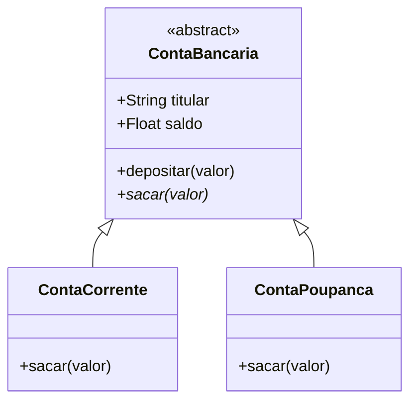

# 🏦 Classes e Métodos Abstratos em Python

## 🎯 Introdução
Classes abstratas definem um modelo padrão para outras classes. Elas não permitem a criação direta de objetos. O objetivo principal é garantir a implementação de métodos específicos. Em Python, utilizamos o módulo nativo `abc`. A classe base precisa herdar diretamente da classe `ABC`. Os métodos abstratos requerem o decorador `@abstractmethod`. Essa estrutura impõe um contrato rigoroso de desenvolvimento.

Considere um sistema de gerenciamento bancário. Toda conta bancária precisa permitir operações de depósito e saque. A classe `ContaBancaria` estabelece essa regra fundamental. As classes `ContaCorrente` e `ContaPoupanca` herdam essa estrutura base. Elas implementam os detalhes específicos de cada operação financeira.

> 💡 **Dica de código:** Use classes abstratas para definir "o que" deve ser feito, deixando o "como" para as subclasses concretas.

## ⚙️ Desenvolvimento e Sintaxe
O módulo `abc` fornece as ferramentas necessárias. A sintaxe exata é `class NomeClasse(ABC):`. Esta declaração transforma a classe em um modelo abstrato. Tentar criar um objeto desta classe gera um `TypeError`.



O método abstrato utiliza o decorador `@abstractmethod`. O decorador fica imediatamente acima da definição do método. O corpo do método abstrato pode conter apenas `pass`.

> ⚠️ **Erro comum de sintaxe:** Esquecer de herdar de `ABC` anula a abstração. O Python permitirá a instanciação indevida da classe.

```python
from abc import ABC, abstractmethod

class ContaBancaria(ABC):
    def __init__(self, titular, saldo):
        self.titular = titular
        self.saldo = saldo

    @abstractmethod
    def sacar(self, valor):
        pass

class ContaCorrente(ContaBancaria):
    def sacar(self, valor):
        if self.saldo >= (valor + 5.0):
            self.saldo -= (valor + 5.0)
            return True
        return False
```

A verificação da abstração ocorre durante a instanciação. Se a subclasse não implementar todos os métodos abstratos, ela também se torna abstrata. A ordem dos decoradores importa: `@abstractmethod` deve ficar sempre mais externo.

## 🏁 Conclusão
Classes e métodos abstratos estabelecem contratos claros. O uso correto torna o código previsível e robusto. Erros de implementação são detectados durante a instanciação. Evite implementar lógica complexa diretamente na classe abstrata. Domine a sintaxe do módulo `abc` para elevar a qualidade do seu software.
