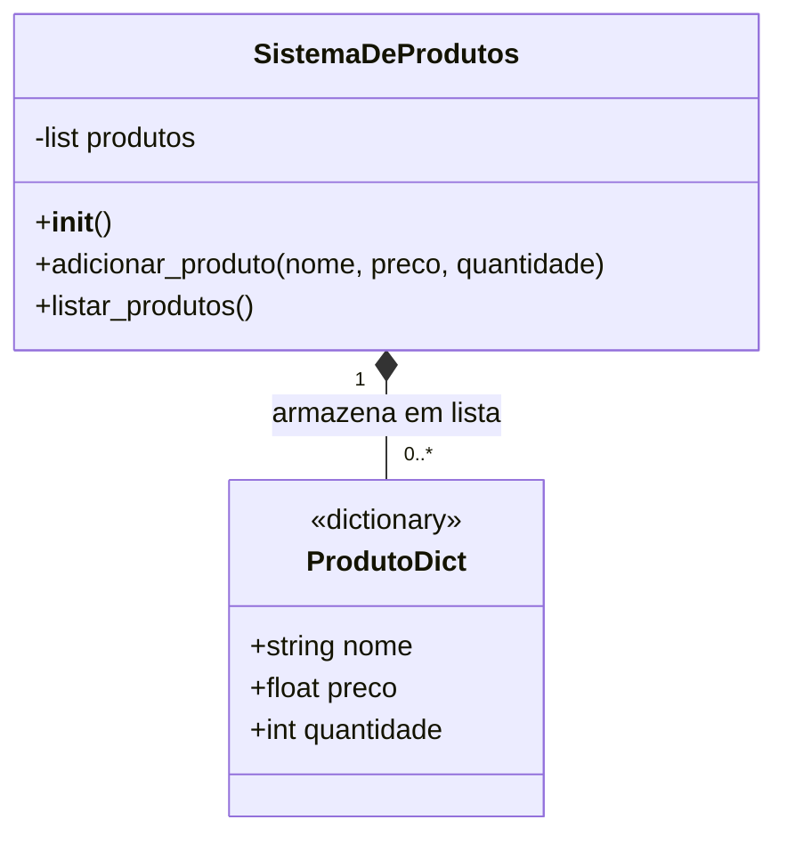

# 📦 Vetores e Coleções em Python

### 🎯 Introdução
O desenvolvimento de software exige o armazenamento de múltiplos valores. Variáveis isoladas tornam o código inviável para grandes volumes de dados. Coleções resolvem este problema. Uma coleção agrupa múltiplos itens em uma única unidade. 

Python oferece quatro coleções nativas principais:
- **Listas (`list`)**: Sequências ordenadas e mutáveis. Equivalente a vetores dinâmicos.
- **Dicionários (`dict`)**: Pares de chave e valor. Acesso rápido via chave.
- **Tuplas (`tuple`)**: Sequências ordenadas e imutáveis.
- **Conjuntos (`set`)**: Itens únicos e não ordenados.

Este material foca na aplicação prática de listas e dicionários em um sistema de cadastro de produtos.

### 🛠️ Desenvolvimento e Sintaxe

A lista utiliza colchetes `[]`. O índice do primeiro elemento é zero. O método `append()` adiciona itens ao final.

> 💡 **Dica de código:** Use `len(lista)` para obter a quantidade total de elementos antes de iterar sobre eles.

O dicionário utiliza chaves `{}`. Ele armazena dados no formato `chave: valor`. O acesso ocorre através da chave.

> ⚠️ **Erro comum de sintaxe:** Tentar acessar uma chave inexistente com colchetes `dict["chave"]` gera um `KeyError`. Use `dict.get("chave")` para retornar `None` com segurança.

#### Diagrama de Classes: Sistema de Produtos


#### Exemplo Prático
O código abaixo modela o `SistemaDeProdutos`. A classe inicializa uma lista vazia. O método de adição valida os dados, cria um dicionário e o insere na lista.

```python
class SistemaDeProdutos:
    def __init__(self):
        self.produtos = []

    def adicionar_produto(self, nome, preco, quantidade):
        if preco < 0 or quantidade < 0:
            print("Erro: Valores devem ser positivos.")
            return
        
        novo_produto = {
            "nome": nome,
            "preco": preco,
            "quantidade": quantidade
        }
        self.produtos.append(novo_produto)

    def listar_produtos(self):
        for item in self.produtos:
            print(f"Nome: {item['nome']} | Preço: {item['preco']}")
```

### 🏁 Conclusão
Listas fornecem flexibilidade para sequências dinâmicas. Dicionários oferecem mapeamento rápido. A combinação de ambos é um padrão robusto. Evite o `IndexError` verificando o tamanho da lista. Escolha a estrutura de dados correta para garantir a integridade do sistema.
